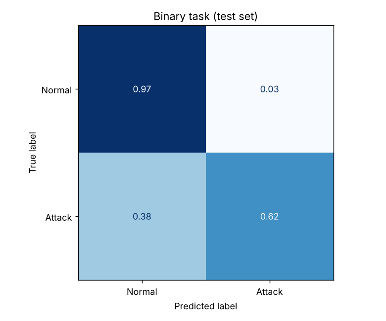
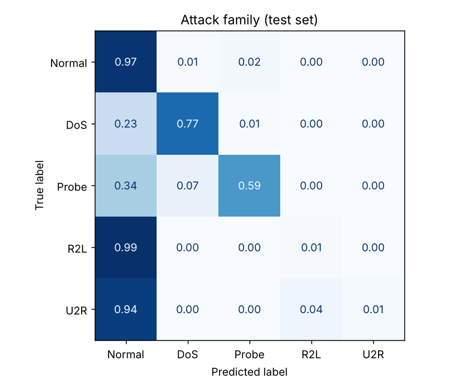
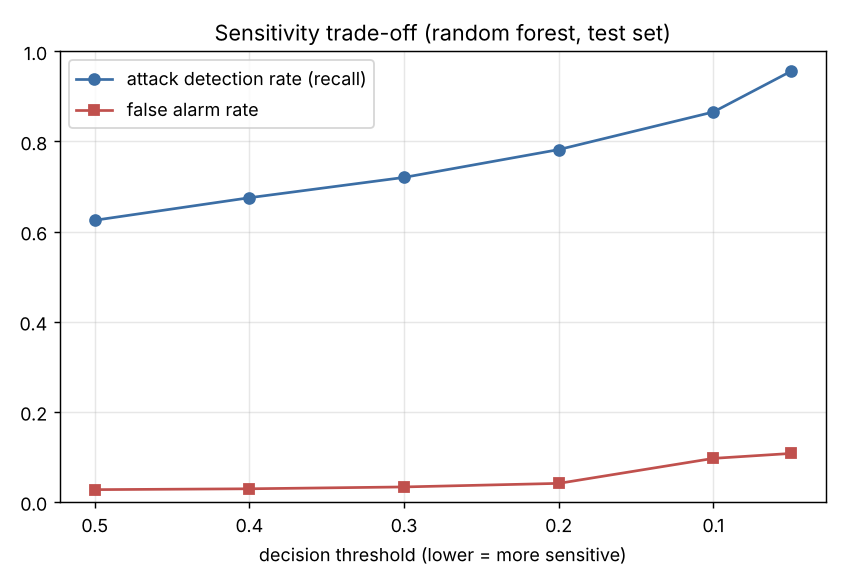
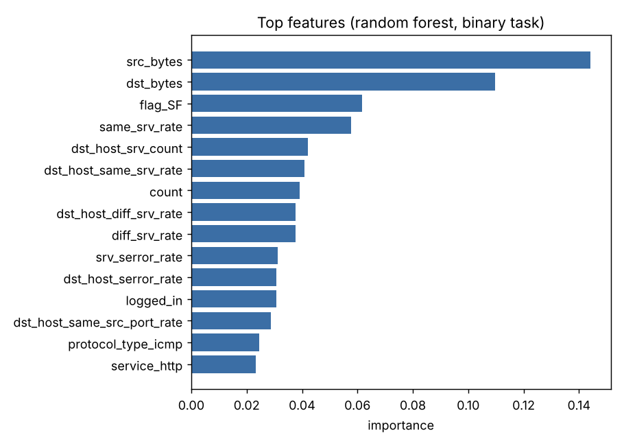

# Network Intrusion Detection with Machine Learning

A machine learning system that inspects network connection records and flags likely attacks, then classifies them into attack families (DoS, Probe, R2L, U2R). Trained and evaluated on the **NSL-KDD** benchmark dataset.

The goal was not only to get a good score but to understand **where an ML-based detector fails**, which matters more in security than headline accuracy.

## Results (official NSL-KDD test set, 22,544 connections)

### Task 1: Attack vs. normal traffic

| Model | Accuracy | Precision | Recall | F1 | ROC-AUC |
|---|---|---|---|---|---|
| Logistic regression (baseline) | 0.754 | 0.917 | 0.625 | 0.743 | 0.792 |
| **Random forest** | **0.775** | **0.968** | **0.625** | **0.760** | **0.963** |

### Task 2: Attack family

Random forest, 5 classes. Accuracy 0.738, macro F1 0.474.

| Class | Normal | DoS | Probe | R2L | U2R |
|---|---|---|---|---|---|
| Recall | 0.97 | 0.77 | 0.59 | 0.01 | 0.01 |




## Key findings

**1. The model struggles with attacks it has never seen.**
The NSL-KDD test set contains 17 attack types that never appear in training (e.g. `mscan`, `apache2`, `snmpguess`).

| | Rows | Detection rate |
|---|---|---|
| Attack types seen in training | 9,083 | **77%** |
| Novel attack types (test only) | 3,750 | **27%** |

This is the core limitation of supervised detection: it learns *known* patterns. It is why real security operations combine ML with signature rules and anomaly detection.

**2. The threshold is a security decision, not just a technical one.**
The ROC-AUC of 0.96 shows the model ranks attacks well even when the default 0.5 cut-off misses them. Lowering the threshold catches far more attacks at the cost of more false alarms:

| Threshold | Detection rate | False alarm rate |
|---|---|---|
| 0.50 | 62.5% | 2.7% |
| 0.20 | 78.2% | 4.1% |
| 0.05 | 95.5% | 10.8% |



In a SOC, a 10% false alarm rate can mean thousands of alerts per day and analyst fatigue, so the right setting depends on the team's capacity. (Note: these thresholds are reported on the test set for analysis; in production they would be chosen on separate validation data.)

**3. Rare, stealthy attacks (R2L, U2R) are nearly invisible.**
U2R has only 52 training examples out of 125,973. Even with class weighting, the model barely detects these. They are also the most dangerous classes, since they involve gaining user or root access.



## How it works

- `src/data.py`: downloads NSL-KDD, maps 39 attack names into 4 families
- `src/train.py`: one-hot encodes protocol/service/flag, trains the models, writes metrics and charts to `results/`
- `src/predict.py`: scores connection records and raises alerts above a chosen threshold

## Run it

```bash
pip install -r requirements.txt
python src/train.py          # downloads data, trains, evaluates (~30 s)
python src/predict.py        # demo on 10 random test connections
python src/predict.py my_connections.csv --threshold 0.2
```

## Next steps

- Add an unsupervised anomaly detector (Isolation Forest / autoencoder) to catch novel attacks
- Try gradient boosting (XGBoost/LightGBM) and compare
- Evaluate on a more modern dataset (CIC-IDS2017 / UNSW-NB15)
- Explain individual alerts with SHAP so an analyst can see *why* a connection was flagged

## Dataset

Tavallaee, M., Bagheri, E., Lu, W., & Ghorbani, A. A. (2009). *A Detailed Analysis of the KDD CUP 99 Data Set.* IEEE CISDA. Canadian Institute for Cybersecurity, University of New Brunswick.
